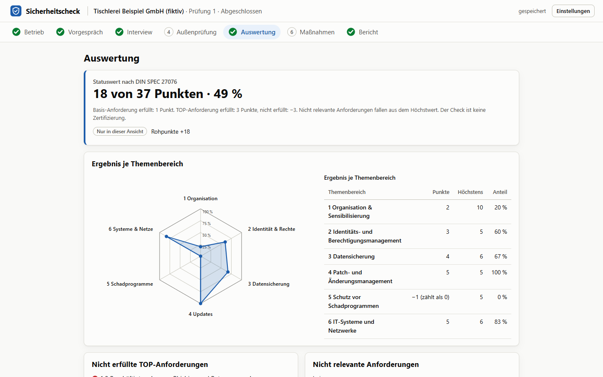
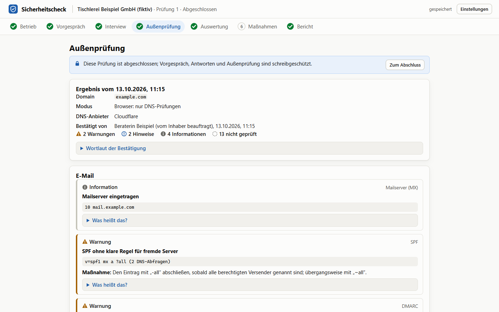
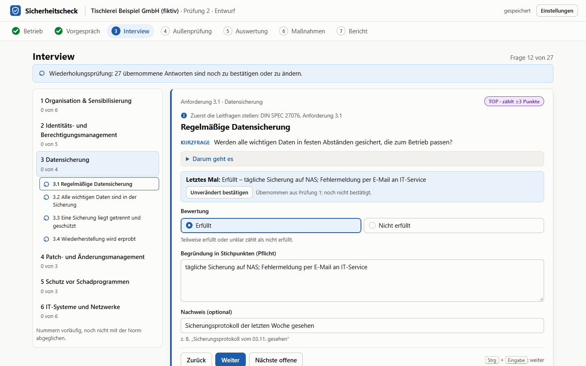
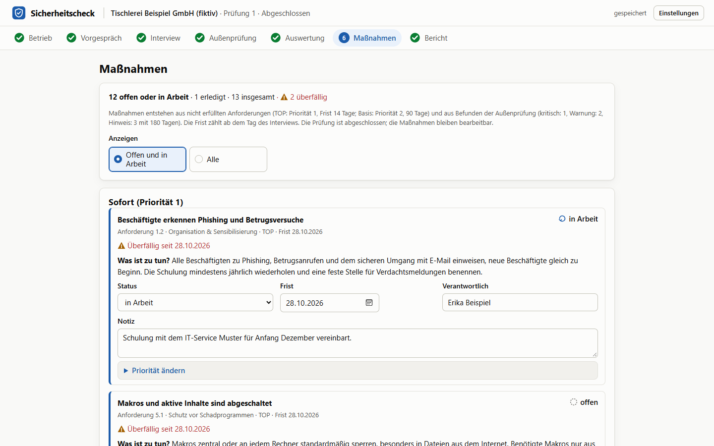
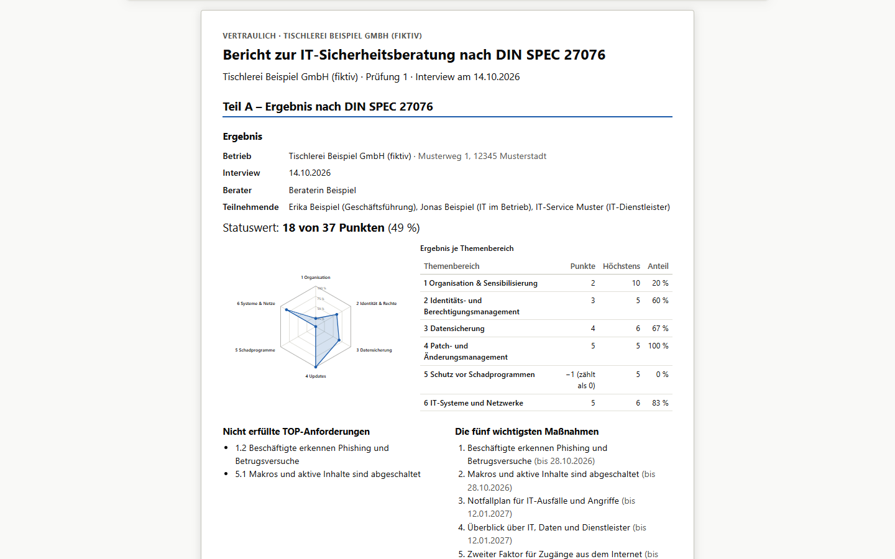

# Sicherheitscheck

Werkzeug für IT-Berater: führt durch die IT-Sicherheitsberatung nach DIN SPEC 27076 für Betriebe mit bis zu 50 Beschäftigten. Geführtes Interview zu 27 Anforderungen, Statuswert nach dem Punkteschema der Norm, passive Prüfung von E-Mail-Domain und Website von außen, priorisierter Maßnahmenplan, Vergleich mit der letzten Prüfung und ein druckfertiger Bericht. Läuft als Windows-Programm oder im Browser, ohne KI und ohne Server; alle Kundendaten bleiben auf dem Rechner des Beraters.

**[Sicherheitscheck für Windows herunterladen](https://github.com/edgebird-lab/sicherheitscheck/releases/latest/download/Sicherheitscheck-Setup.exe)** (neueste Version, alle Versionen unter [Releases](https://github.com/edgebird-lab/sicherheitscheck/releases))



> **Gut zu wissen:** Der Check folgt der DIN SPEC 27076, alle Fragen, Erläuterungen und Maßnahmen sind aber eigene Formulierungen, kein Normtext. Die App ist nicht vom BSI zertifiziert oder mit ihm abgestimmt, und der Check ist keine Zertifizierung. Die Außenprüfung ist passiv und nur für eigene Domains oder Domains gedacht, mit deren Prüfung man beauftragt ist.

## Herunterladen und installieren

1. [Sicherheitscheck-Setup.exe](https://github.com/edgebird-lab/sicherheitscheck/releases/latest/download/Sicherheitscheck-Setup.exe) herunterladen (rund 2 MB).
2. Doppelklick auf die Datei. Der Installer ist nicht signiert; Windows SmartScreen kann deshalb nachfragen. Dann „Weitere Informationen“ und „Trotzdem ausführen“ wählen.
3. Der Sicherheitscheck installiert sich pro Benutzer ohne Admin-Rechte, mit Eintrag im Startmenü und Verknüpfung auf dem Desktop.
4. Zum Ausprobieren auf der Startseite „Beispielbetrieb laden“ wählen.

Voraussetzung ist Windows 10 oder 11 mit WebView2. Die Laufzeit ist dort meist schon vorhanden; sonst lädt der Installer sie von Microsoft nach. Eine neue Version installiert sich über die vorige, die Daten bleiben erhalten. Wer Node 24 hat, kann statt des Programms die [Web-Version](#starten-im-browser) selbst bauen und lokal im Browser nutzen, dort ohne Prüfung der Website.

**Stand 0.1.0:** erste veröffentlichte Version. Der Katalog ist noch nicht Satz für Satz mit dem Normtext abgeglichen, und die Website-Prüfung ist bisher nur gegen Testserver geprüft (siehe [Grenzen](#grenzen)). Fortschritt und offene Punkte: [docs/stand.md](docs/stand.md), Annahmen: [docs/entscheidungen.md](docs/entscheidungen.md).

## Was es kann

- **Geführter Ablauf in sieben Schritten:** Betrieb, Vorgespräch, Interview, Außenprüfung, Auswertung, Maßnahmen, Bericht. Ein Häkchen in der Schrittleiste zeigt, was vollständig ist.
- **Interview mit Fragekarte:** je Anforderung Themenbereich, TOP-Kennzeichen („zählt ±3 Punkte“), Verweis auf die Leitfragen der Norm, eigene Kurzfrage und „Darum geht es“. Bewertung erfüllt, nicht erfüllt oder (wo erlaubt) nicht relevant, Begründung als Pflicht, Nachweis optional. Bedienbar nur mit der Tastatur. Eine laufende Punktzahl zeigt das Interview bewusst nicht.
- **Vorfragen im Vorgespräch** blenden Anforderungen aus, die nicht zutreffen (z. B. WLAN), und begründen das automatisch. Warnung, solange niemand aus der Geschäftsführung teilnimmt.
- **Außenprüfung der E-Mail-Domain:** MX, SPF (mit rekursiver Zählung der DNS-Abfragen), DMARC, DKIM (mit bekanntem Selektor, Schlüssellänge aus dem Schlüssel), MTA-STS, TLS-RPT, DNSSEC und CAA über DNS über HTTPS (Cloudflare oder Google). Im Windows-Programm außerdem die Website: Weiterleitung auf HTTPS, Erreichbarkeit, Zertifikat, TLS-Version, HSTS, sieben Sicherheits-Header, Cookies, security.txt und die MTA-STS-Richtlinie. Nur passiv und erst nach Bestätigung der Zuständigkeit; Grenzen je Lauf, Abbrechen, Abrufprotokoll. Jede Stufe hat Symbol und Wort, jeder Befund „Was heißt das?“ und eine Maßnahme.
- **Auswertung:** Statuswert, Rohpunkte (nur in der Berateransicht), Netzdiagramm mit Tabelle je Themenbereich, nicht erfüllte TOP-Anforderungen, nicht relevante Anforderungen, Zusammenfassung der Außenprüfung, bei Wiederholung der Vergleich mit der letzten Prüfung (besser, schlechter, neu, entfallen).
- **Maßnahmenplan:** abgeleitet aus nicht erfüllten Anforderungen und Befunden, Priorität und Frist nach festen Regeln (14, 90, 180 Tage), Status, Verantwortliche, Notizen, überfällige Fristen; Priorität von Hand nur mit Begründung. Maßnahmen aus der Außenprüfung verschwinden erst, wenn ein neuer Lauf die Ursache widerlegt.
- **Bericht:** Vorschau im Druckbild, „Drucken / als PDF“ auf A4, immer hell: Teil A Ergebnis nach DIN SPEC 27076, Teil B Prüfung von außen (Zusatz), Teil C Maßnahmenplan, Vergleich, Anhang mit Fördermöglichkeiten, Bezug zum IT-Grundschutz, Methodik und Grenzen, Abrufprotokoll und Unterschriftsfeldern. [Beispielbericht als PDF](docs/bilder/beispielbericht.pdf).
- **Abschluss und Wiederholung:** Beim Abschließen wird das Ergebnis eingefroren. Eine Wiederholungsprüfung übernimmt Teilnehmende, Vorfragen, Antworten und offene Maßnahmen; jede übernommene Antwort muss bestätigt oder geändert werden.
- **Daten lokal:** IndexedDB im Browser, Speichern nach jeder Änderung, Schutz vor zwei gleichzeitig offenen Tabs. Beschädigte Einträge werden beim Laden übersprungen und gemeldet, nicht gelöscht; Daten einer neueren Version öffnet die App nicht und lässt sie unverändert. Schlägt das Speichern fehl, zeigt der Kopf das, und die App versucht es erneut. Sicherung als Datei `.sicherheitscheck`, standardmäßig verschlüsselt (Argon2id, AES-256-GCM, im Web Worker).
- **Fiktiver Beispielbetrieb** „Tischlerei Beispiel GmbH“ mit abgeschlossener Prüfung, fiktiver Außenprüfung von `example.com` und Maßnahmenplan.



## Bewertung nach DIN SPEC 27076

| Anforderung | erfüllt | nicht erfüllt, teilweise oder offen | nicht relevant |
| --- | --- | --- | --- |
| Basis (22) | 1 Punkt | 0 Punkte | fällt aus dem Höchstwert |
| TOP (5) | 3 Punkte | −3 Punkte | – (immer relevant) |

Statuswert = Summe der Punkte, ausgewiesen mindestens 0; Höchstwert 37, wenn alles relevant ist. Der Beispielbetrieb erfüllt 3 TOP- und 15 Basis-Anforderungen: 3 × 3 − 2 × 3 + 15 = **18 von 37 Punkten (49 %)**. Je Themenbereich gilt dieselbe Rechnung; das Netzdiagramm zeigt den Anteil an den Höchstpunkten.

**Kein Normtext:** Die Norm ist urheberrechtlich geschützt. Die App enthält nur Nummer, Themenbereich, TOP-Kennzeichen und Punkteschema; Fragen, Erläuterungen und Maßnahmen sind eigene Formulierungen. Die Leitfragen stellt der Berater aus der Norm, die er selbst bei DIN Media bezieht. Der Katalog ist noch nicht mit der Norm abgeglichen ([Abgleichblatt](docs/katalog-abgleich.md), [alle Texte](docs/katalog-texte.md)). Die App ist kein Angebot des BSI und nicht von ihm zertifiziert; der Check ist keine Zertifizierung.



## Prüfung von außen

Die Außenprüfung liest nur, was jeder Besucher oder Mailserver auch abrufen kann: keine Portscans, keine Anmeldeversuche, keine Formulareingaben. Trotzdem ist sie nur für eigene Domains oder für Domains gedacht, mit deren Prüfung man beauftragt ist. Vor jedem Lauf bestätigt der Berater das mit Name und Rolle; die Bestätigung steht im Bericht und ersetzt keinen schriftlichen Auftrag.

| Prüfung | Was gelesen wird | Beispiele für Regeln |
| --- | --- | --- |
| MX | MX der Domain | Null-MX, Liste nach Priorität; NXDOMAIN beendet den Lauf |
| SPF | TXT der Domain, rekursiv über include und redirect | mehrere Einträge, mehr als 10 DNS-Abfragen, Schleifen, `+all` (kritisch), `?all` |
| DMARC | TXT unter `_dmarc` | nur „v=DMARC1“ in genau dieser Schreibweise, `p=none` mit und ohne Berichte, `pct`, `sp=none` |
| DKIM | TXT unter `‹selektor›._domainkey` | widerrufener Schlüssel, RSA unter 1024 / 2048 Bit, Ed25519 |
| MTA-STS, TLS-RPT | TXT unter `_mta-sts` und `_smtp._tls` | gültige id, Berichte bei MTA-STS; die Richtlinie selbst prüft das Windows-Programm |
| DNSSEC | SOA mit und ohne Prüfung (`cd=1`) | nicht signiert, Signatur kaputt (kritisch) |
| CAA | CAA der Domain und ihrer Elternnamen | keine Einträge, kein `issue`, unbekannte kritische Angabe |
| Website (nur Windows-Programm) | A und AAAA für D und www.D, dann `http://` und `https://` der Startseite mit Weiterleitungen innerhalb der Domain | unverschlüsselt erreichbar, Umleitung nur vorübergehend oder über HTTP, zu viele Weiterleitungen, HTTPS mit TLS-Fehler (kritisch) |
| Zertifikat, TLS-Version | TLS-Handshake mit D, www.D und mta-sts.D | nicht vertrauenswürdig, falscher Name, abgelaufen (kritisch), läuft in unter 7 / 14 Tagen ab, nur TLS 1.2 |
| HSTS, Sicherheits-Header, Cookies | Kopfzeilen der ersten bzw. letzten HTTPS-Antwort | kein oder zu kurzes HSTS, keine CSP, kein Schutz vor Einbettung, Versionsangaben im Server, Cookies ohne `Secure` |
| security.txt | `https://D/.well-known/security.txt` | fehlt, unvollständig, abgelaufen |

Die Regeln stehen mit Stufe in der Spezifikation (6.5, 6.6), die Texte für Laien in `src/katalog/regeltexte.ts`. Der DoH-Anbieter sieht die abgefragten Namen und die IP-Adresse des Beraters; Google bekommt keine Angaben zum Netz (`edns_client_subnet=0.0.0.0/0`). Website, Zertifikat, TLS und Sicherheits-Header kann ein Browser nicht prüfen; das übernimmt das Windows-Programm. Dort gehen HTTP und TLS nur an die bestätigte Domain und ihre Subdomains (Freigabe im Rust-Teil für 15 Minuten), nie an private Adressen, ohne Weiterleitungen auf fremde Domains, mit höchstens 32 HTTP-Abrufen, 3 TLS-Verbindungen, 10 s je Abruf und 64 KiB Text (nur unter `/.well-known/`); von den Kopfzeilen kommen nur die zwölf geprüften an, Cookie-Werte nie.



## Aufbau

| Ordner | Inhalt |
| --- | --- |
| `src/katalog` | 6 Themenbereiche, 27 Anforderungen, Vorfragen, Bezug zum IT-Grundschutz, Regeltexte der Außenprüfung |
| `src/modell` | Datenmodell, Bewertung, Operationen, Maßnahmen, Vergleich, Fortschritt, Netzdiagramm, Beispielbetrieb |
| `src/netz` | Netz-Schnittstelle, DNS über HTTPS im Browser, Netz des Windows-Programms (Rust-Befehle), Testnetz mit nachgebildeten Antworten |
| `src/pruefung` | Domainprüfung (Public Suffix List), Lauf mit Grenzen und Protokoll, Regeln je Prüfung (E-Mail, DNS, Website, Zertifikat, Header, security.txt), Ablauf |
| `src/speicher` | Prüfung beim Laden, Migration, IndexedDB, Schreibpuffer, Tab-Sperre, Export und Import, Verschlüsselung |
| `src/plattform` | Browser oder Windows-Programm: Export, Import, PDF, Fenstertitel, Speichern vor dem Schließen, Netz der Außenprüfung |
| `src/ui` | React-Oberfläche, Bericht mit Druck-CSS |
| `src-tauri` | Windows-Programm: Rust-Befehle für Dateien, PDF und Netz, Rechte, CSP, Installer, Symbol |
| `src-tauri/netzpruefung` | Crate ohne Tauri: Freigabe, Zielprüfung mit Adresssperre, DNS über HTTPS, HTTP ohne Weiterleitung, TLS-Angaben (rustls mit ring, webpki-roots, x509-parser) |
| `testdaten` | synthetische DoH-Antworten beider Anbieter, fiktive Zone des Beispielbetriebs |
| `e2e` | Browsertests mit Playwright und axe |
| `docs` | Spezifikation, Stand, Entscheidungen, Katalog-Abgleich, Lizenzen, Bilder und Beispielbericht |

Die Fachlogik kennt kein React und ist vollständig getestet. **Technik:** React 19, TypeScript 7, Vite 8, tldts, idb, @noble/hashes, Vitest, Playwright mit axe, oxlint, Tauri 2 (Rust, WebView2, NSIS), GitHub Actions.



## Qualität

- 341 Unit-Tests in 33 Dateien mit von Hand nachgerechneten Werten, darunter alle Fälle der Spezifikation für Katalog, Statuswert, Abschluss, Wiederholung, Laden, Export und Import, Domain und DNS, alle E-Mail- und Website-Regeln, Zertifikat und TLS, Ablauf der Außenprüfung im Browser und im Windows-Programm, Maßnahmen, Vergleich und Netzdiagramm (T-K, T-B, T-O, T-L, T-E, T-D, T-N, T-MX, T-S, T-M, T-DK, T-T, T-RP, T-DS, T-CA, T-W, T-Z, T-A, T-P, T-V, T-G), dazu Stichproben der Durchsicht (gemischte Relevanz, Fristen über Jahreswechsel und Schaltjahr, Prozentrundung für jeden möglichen Punktestand, SPF mit include und redirect). Kein Unit-Test fragt echte Domains ab; DKIM-Schlüssel entstehen zur Laufzeit.
- 33 Browsertests: Betrieb anlegen und neu laden, Vorgespräch mit Vorfragen, Interview vollständig per Tastatur, Außenprüfung mit nachgebildeten DoH-Antworten (keine Anfrage verlässt den Test), Abbrechen, Maßnahme erledigen und neu laden, Priorität von Hand, Wiederholung mit Vergleich und Rückfrage bei weiterem Entwurf, Bericht als Druckansicht und PDF, verschlüsselter Export und Import, zweiter Tab, beschädigte oder zu neue Daten beim Laden, Arbeiten ohne IndexedDB, Speicherfehler mit erneutem Versuch.
- Barrierefreiheit: axe meldet auf keiner Seite, in keinem Schritt, in keinem Dialog und während der Außenprüfung schwere Befunde, weder hell noch dunkel; jedes Eingabefeld ist beschriftet; nach jedem Seitenwechsel steht der Fokus auf der Überschrift. Jede Stufe hat Symbol und Wort.
- 36 Rust-Tests (`cargo test --workspace` in `src-tauri`), davon 32 in der Crate `netzpruefung` (T-R01 bis T-R14): Freigabe und Public Suffix List, Adresssperre für alle gesperrten Bereiche, HTTP gegen Testserver auf 127.0.0.1 (keine Weiterleitung, Größen- und Zeitgrenze, Kopfzeilenfilter, Cookie-Werte entfernt), TLS gegen einen rustls-Testserver mit zur Laufzeit erzeugter Test-CA (abgelaufen, fremder Name, unbekannte Stelle, nur TLS 1.2). Kein Rust-Test fragt einen fremden Rechner ab.
- Desktop-Test (`npm run desktop:test`) gegen das echte Programm: sicherer Kontext, Beispielbetrieb, verschlüsselt exportieren, alles löschen, importieren (Daten gleich), zweiter Start mit einer Sicherung (Rückfrage), PDF in A4, Netzbefehle ohne Freigabe abgelehnt, Außenprüfung mit nachgebildeten DoH-Antworten (kein HTTP- oder TLS-Abruf), Speichern beim Schließen, keine CSP-Verstöße.
- Vor jedem Commit laufen Lint, Unit-Tests, Build und die Browsertests lokal mit Edge. Die CI prüft Lint, Unit-Tests, Build und die Netztests der Crate bei jedem Push (`ci.yml`); bei Änderungen am Programmteil baut `windows.yml` Programm und Installer und testet die Installation; `release.yml` baut bei einem Tag `v*` den Installer und legt einen Release-Entwurf mit `Sicherheitscheck_<Version>_x64-setup.exe` und der gleichen Datei unter dem festen Namen `Sicherheitscheck-Setup.exe` an.

## Windows-Programm

Das Programm (Tauri 2 mit WebView2) installiert sich pro Benutzer ohne Admin-Rechte nach `%LOCALAPPDATA%\Sicherheitscheck`, mit Eintrag im Startmenü, Verknüpfung auf dem Desktop und der Dateizuordnung `.sicherheitscheck` (Doppelklick auf eine Sicherung importiert sie nach einer Rückfrage). Gegenüber dem Browser kann es:

- Sicherungen mit „Speichern unter“ an einen gewählten Ort schreiben und über einen Öffnen-Dialog importieren; geschrieben wird nur dorthin, wo der Benutzer es im Dialog wählt, und immer über eine Hilfsdatei mit Umbenennen.
- den Bericht ohne Druckdialog als PDF auf A4 speichern.
- beim Schließen des Fensters zuerst speichern.

Die Daten liegen wie im Browser in einer IndexedDB, hier im Profil der WebView2 unter `%LOCALAPPDATA%\de.olbricht-digital.sicherheitscheck`. Eine Deinstallation lässt sie stehen; trotzdem vorher eine Sicherung exportieren. Die Oberfläche hat keine allgemeinen Datei-, HTTP- oder Shell-Rechte, nur die eigenen Befehle des Rust-Teils; die CSP erlaubt Verbindungen nur zur Brücke zu Rust und zu den beiden DoH-Anbietern.

```bash
npx tauri build                      # Installer: <Ziel>/release/bundle/nsis/Sicherheitscheck_<Version>_x64-setup.exe
npx tauri build --debug --no-bundle  # Debug-Build für den Desktop-Test
npm run desktop:test                 # Desktop-Test gegen den Debug-Build (CDP-Port 9336)
```

Zum Selbstbauen braucht es Rust 1.90 oder neuer und Node 24. Der Desktop-Test legt die Programmdaten vorher beiseite und stellt sie danach wieder her; er bricht ab, solange der Sicherheitscheck läuft. Der Installer ist noch nicht signiert; SmartScreen kann beim ersten Start nachfragen.

## Starten im Browser

Voraussetzung ist Node 24. Die Web-Version läuft nur lokal im Browser (Edge oder Chrome); eine gehostete Fassung gibt es nicht, die Daten bleiben im Browser.

```bash
npm install
npm run build     # Typprüfung und Produktions-Build (mit Content-Security-Policy)
npm run preview   # App unter http://localhost:4181 (Port fest; 4173 gehört dem Prozesslotsen)
```

Zum Ausprobieren auf der Startseite „Beispielbetrieb laden“ wählen. Die Daten liegen in der IndexedDB des Browsers für `localhost:4181`; eine verschlüsselte Sicherung entsteht über „Sicherung exportieren“.

## Entwickeln

```bash
npm run dev       # Entwicklungsserver (ohne Content-Security-Policy)
npm test          # Unit-Tests (Vitest)
npm run e2e       # Browsertests (lokal mit Edge auf Port 4181)
npm run lint      # oxlint
```

`npm run e2e` startet die Vorschau selbst. Läuft auf Port 4181 schon eine, nutzt Playwright sie ohne neuen Build; dann vorher `npm run build`. `npm run bilder` erzeugt die Bilder dieser README und den Beispielbericht neu (bei laufender Vorschau auf Port 4181).

## Grenzen

- Der Katalog ist vorläufig: Nummern, Verteilung der Basis-Anforderungen und Relevanzregeln sind Annahmen bis zum Abgleich mit der Norm.
- Netzdiagramm, Dringlichkeit und Aufbau des Berichts sind Annahmen der Spezifikation (6.12, 6.13); „Methodik und Grenzen“ soll vor dem ersten bezahlten Auftrag anwaltlich geprüft werden.
- Die Außenprüfung ist passiv und findet nicht alle Schwachstellen. Nicht geprüft: Mailserver per SMTP, alte TLS-Versionen im Einzelnen, Sperrstatus von Zertifikaten, Unterseiten der Website; im Browser außerdem die Website. Einige Regeln stützen sich auf noch nicht geöffnete RFCs ([Prüfblatt für Phase 0.4](docs/rfc-abgleich.md)). Die Website-Prüfung ist nur gegen Testserver und nachgebildete Antworten getestet; die Abnahme mit echten eigenen Domains (M-01) steht aus.
- Die Daten liegen unverschlüsselt in der IndexedDB des Browsers bzw. der WebView2. Für den Rechner des Beraters gelten BitLocker und Bildschirmsperre; regelmäßig eine verschlüsselte Sicherung exportieren.

## Haftung

Der Sicherheitscheck ist ein Hilfsmittel für die Beratung und ersetzt nicht das Urteil des Beraters. Das Ergebnis beruht auf den Auskünften der Teilnehmenden am Tag des Interviews und beschreibt den Stand zu diesem Zeitpunkt. Der Check ist keine Zertifizierung und kein Audit und bewertet keine Rechtslage, etwa nach DSGVO, NIS2 oder TDDDG. Die passive Prüfung von außen findet nicht alle Schwachstellen; ein Virenschutz oder Proxy auf dem Rechner des Beraters kann Angaben zu Zertifikaten verfälschen. Für Vollständigkeit und Richtigkeit der Ergebnisse wird keine Gewähr übernommen. Den vollständigen Text „Methodik und Grenzen“ druckt die App im Anhang jedes Berichts.

## Rechte

© 2026 Robin Olbricht – olbricht-digital. Alle Rechte vorbehalten. Die Programme dürfen kostenlos genutzt werden; eine offene Lizenz ist noch nicht gewählt. Fremdbestandteile stehen unter ihren eigenen Lizenzen, siehe [docs/lizenzen.md](docs/lizenzen.md).

„DIN SPEC 27076“ bezeichnet die Norm, nach der der Check vorgeht. Die Norm selbst ist nicht Teil dieses Repos.
